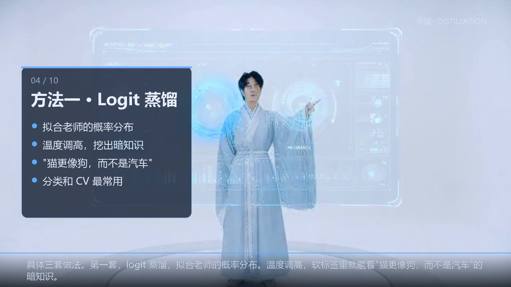

# 蒸馏技术讲解 · H3 生成

70 秒中文技术讲解视频。画面里的讲解员是**用 MiniMax-H3 参考图模式生成的**——基于一张人像照片保持人物一致性，站在超现代全息面板前讲解「模型蒸馏」。

- **成片**：`distillation_explainer.mp4`（1920×1080 / 24fps / **68.8 秒** / 中文配音 + 字幕）
- **生成环境**：AMD RX 6900 XT（gfx1030，16 GB）+ ROCm 7.2 + stable-diffusion.cpp



## 成片规格

| 项 | 值 |
|---|---|
| 时长 | 68.79 秒 |
| 分辨率 / 帧率 | 1920×1080 / 24 fps |
| 视频 | H.264 High，21.1 MB |
| 音频 | AAC 44.1 kHz，平均 -23.6 dB / 峰值 -0.5 dB（无削波）|
| 配音 | Windows SAPI `Microsoft Huihui`，Rate 5（6.6 字/秒）|
| 讲稿 | 472 字，10 段 |
| H3 镜头 | 7 个，各 2 秒（640×384），慢放 3 倍轮换 |

## 制作管线

```
人像照片 (1080×1080)
   │
   ├─ H3 Ref2VA 参考图模式 ──► 候选镜头（640×384，2 秒/个）
   │      每镜头 258–530 秒；参考图模式比普通模式慢约 4 倍
   │      ↓ 人工筛选（眼镜/景别/人脸一致性）
   │   7 个合格镜头
   │
   ├─ 讲稿 472 字 ──► 逐段 TTS（10 段 WAV，合计 68.8 秒）
   │
   ├─ Pillow ──► 10 张 1920×1080 透明叠加层（标题/要点/字幕，卡片高度自适应）
   │
   └─ ffmpeg ──► 每段：镜头慢放 3 倍 + 叠加层 + 该段配音
                     └─► 拼接成片
```

### 关键取舍

| 问题 | 实测 | 决策 |
|---|---|---|
| 参考图模式成本 | 每帧约 9.8 秒，70 秒全 H3 = **约 5.2 小时** | 用 7 个 2 秒镜头慢放轮换 |
| 中文渲染 | 扩散模型画不出汉字 | 文字全部后期合成 |
| 人物一致性 | 约 2/7 的镜头会凭空出现眼镜 | 人工筛选后丢弃 |
| 景别控制 | "wide full body shot" 命中率约 70%，偶尔出中景 | 筛选 |
| 负面提示词 | **"no glasses" 反而诱导眼镜** | 提示词里绝不提眼镜 |

## 复现

```powershell
# 1) 配音（需要 Windows 中文语音 Microsoft Huihui）
py pipeline\gen_tts.py

# 2) 叠加层
py pipeline\make_overlays.py

# 3) H3 镜头（需要 sd-cli + Q4_K 模型 + 参考图）
powershell -File pipeline\gen_clips3.ps1

# 4) 合成（参数是选用的镜头名）
py pipeline\assemble.py b d g2 g3 g4 g5 g6
```

## 踩过的坑

1. **PowerShell 5.1 读无 BOM 的 UTF-8 脚本会乱码**：脚本里不要写中文路径，先把图复制成 ASCII 名。
2. **负面词写进正向提示会起反作用**：写 "no glasses" 会让模型加眼镜。
3. **参考图模式不能用首帧**：`-i` 是首帧（FL2VA），`-r` 才是角色参考（Ref2VA），两者效果完全不同。
4. **卡片文案必须按 token 换行**：按字符换行会把 `token`、`Qwen3` 拆断。
5. **慢放比循环自然**：2 秒镜头用 `setpts=3*PTS` 拉到 6 秒，比循环播放更不像卡带。

## 讲稿

见 [script.md](script.md)。

## 许可

讲稿为本仓库自撰；画面由本地模型生成。模型权重版权归各自发布方。
